<div align="center">

# 📝 Quiz · Fiche de séance

### 15 questions en 6 minutes pour vérifier que l'on sait rédiger une fiche de séance complète

**Médiateur Numérique (RNCP 40695) · Centre de Formation MODE 83 · Ondea Web Studio**

[](https://pythonman83.github.io/quiz-fiche-de-seance/)
[](https://ko-fi.com/ondeaweb)


<br>

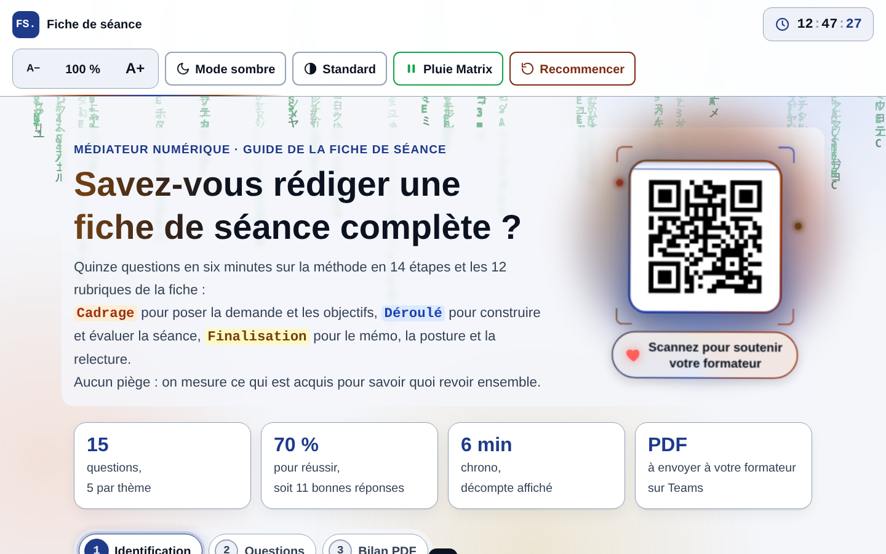

</div>

---

## 📚 Sommaire

- [Présentation](#-présentation)
- [Aperçu en images](#-aperçu-en-images)
- [Déroulement du quiz](#-déroulement-du-quiz)
- [Le décompte de 6 minutes](#-le-décompte-de-6-minutes)
- [Les 15 questions](#-les-15-questions)
- [Le bilan et le PDF](#-le-bilan-et-le-pdf)
- [Fonctionnalités](#-fonctionnalités)
- [Structure du projet](#-structure-du-projet)
- [Mise en ligne sur GitHub Pages](#-mise-en-ligne-sur-github-pages)
- [Utilisation en local](#-utilisation-en-local)
- [Personnalisation](#-personnalisation)
- [Accessibilité](#-accessibilité)
- [Données enregistrées](#-données-enregistrées)
- [Compatibilité](#-compatibilité)
- [Auteur et soutien](#-auteur-et-soutien)

---

## 🎯 Présentation

Ce quiz accompagne le **[Guide de la fiche de séance](https://pythonman83.github.io/fiche-de-seance/)** : la méthode en 14 étapes et les 12 rubriques pour rédiger une fiche d'atelier de médiation numérique.

Il permet au stagiaire de vérifier en **6 minutes** qu'il maîtrise la méthode, puis d'envoyer son **bilan PDF** à son formateur sur Microsoft Teams.

Les 15 questions sont réparties en **trois thèmes de 5 questions** :

| Thème | Couleur | Ce qui est vérifié | Étapes du guide |
|---|:---:|---|:---:|
| 🟧 **Cadrage** | Orange | Phrase-boussole, cadre de référence, informations générales, objectifs | 00 à 03 |
| 🟦 **Déroulé** | Bleu | Matériel, méthodes, tableau de déroulé, évaluation des acquis | 04 à 07 |
| 🟨 **Finalisation** | Jaune | Mémo, accessibilité, posture, ressources, bilan | 08 à 13 |

> 💡 Toute l'application tient dans **un seul fichier `index.html`**. Aucune donnée n'est envoyée sur internet : les réponses restent sur l'ordinateur du stagiaire.

---

## 🖼️ Aperçu en images

### Ouverture animée

Un rideau s'ouvre sur le titre **FICHE · MN**, lettre par lettre. Un clic ou une touche permet de passer l'animation.

<div align="center">
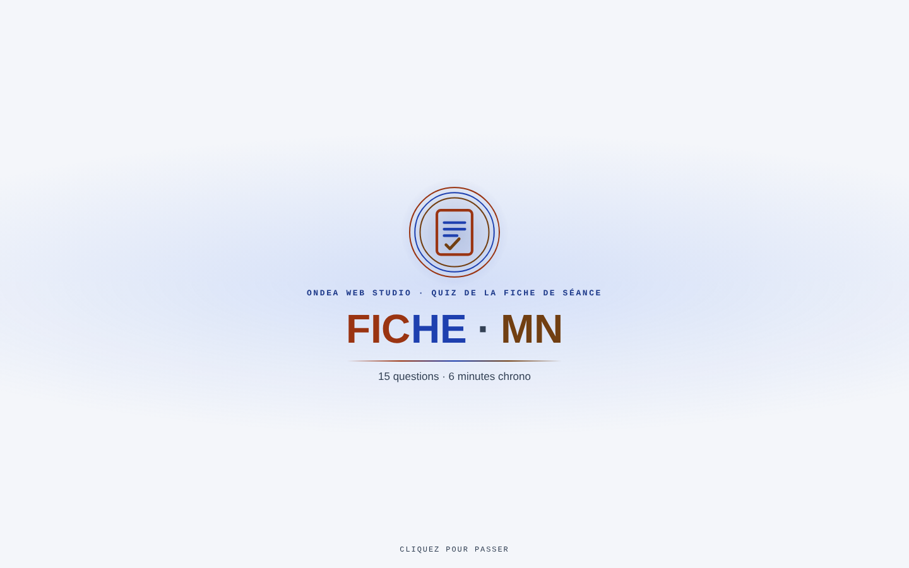
</div>

### Accueil en mode clair et en mode sombre

| Mode clair | Mode sombre |
|:---:|:---:|
|  |  |

### 1. Identification

Le quiz ne démarre qu'une fois le prénom et le nom remplis. Les règles, dont la durée de 6 minutes, sont rappelées juste au-dessus du bouton.

<div align="center">
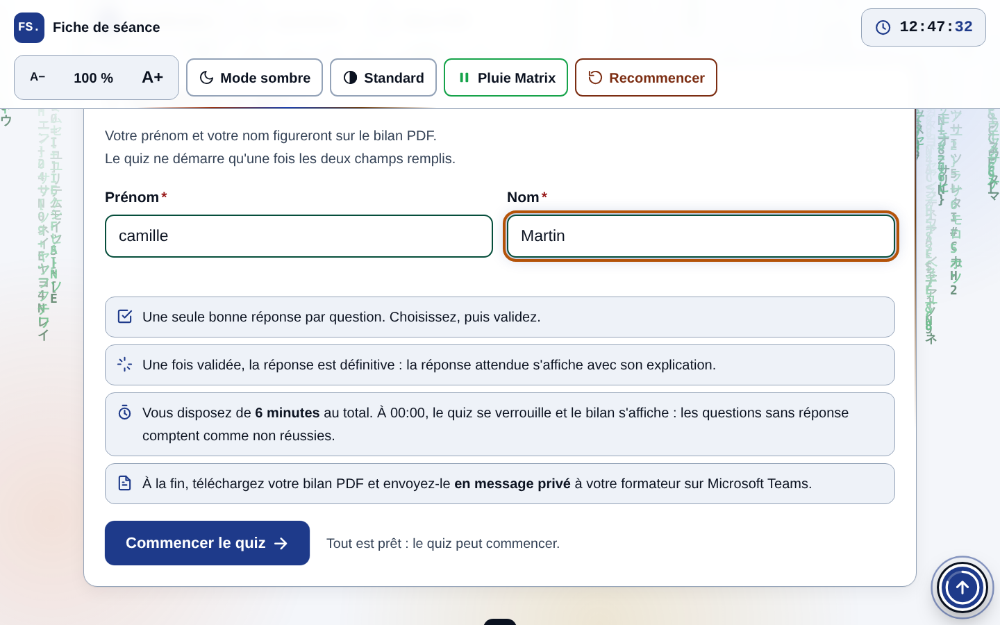
</div>

### 2. Les questions, avec le décompte

Le panneau **Temps restant** reste visible en haut de chaque question.

<div align="center">
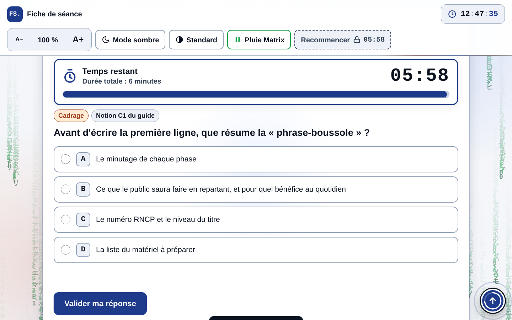
</div>

### Correction immédiate

| Bonne réponse | Mauvaise réponse |
|:---:|:---:|
| 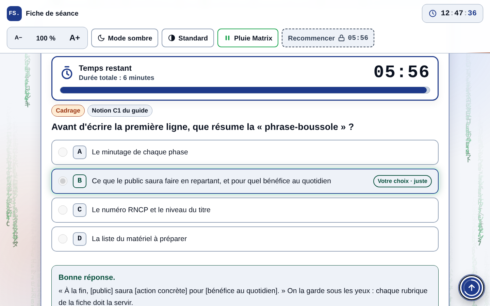 | 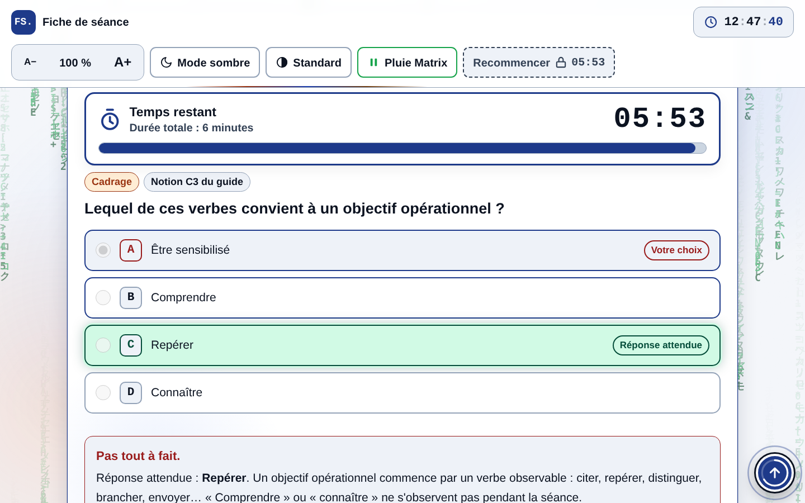 |

### Moins de 2 minutes : passage à l'orange

<div align="center">
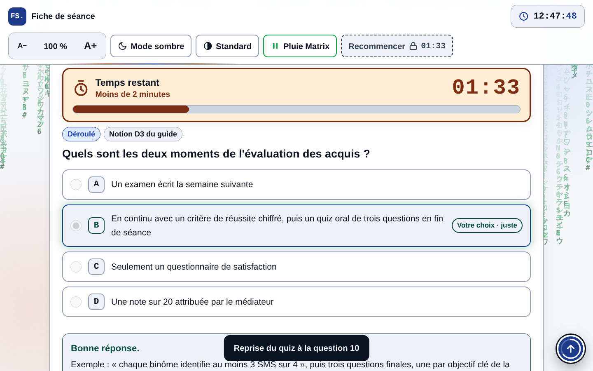
</div>

### 3. Le bilan

Score, jauge avec le seuil de 70 %, résultats par thème, commentaire personnalisé et notions du guide à revoir.

<div align="center">
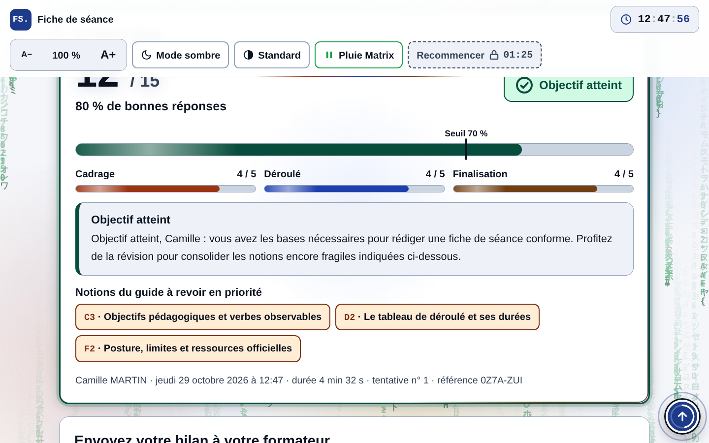
</div>

### Envoi sur Microsoft Teams

<div align="center">
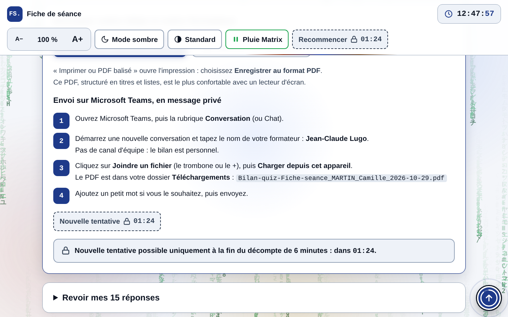
</div>

### Temps écoulé

À 00:00, les réponses sont verrouillées et le bilan s'affiche. Les questions restées sans réponse sont signalées.

| Verrouillage à 00:00 | Bilan après temps écoulé |
|:---:|:---:|
| 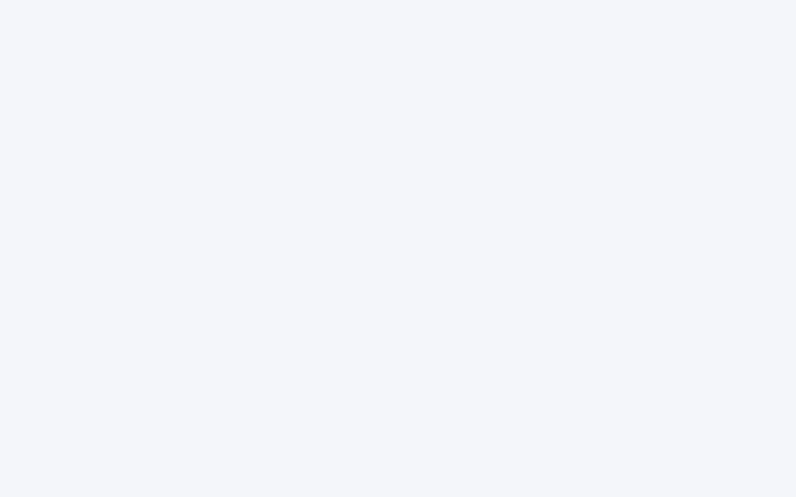 | 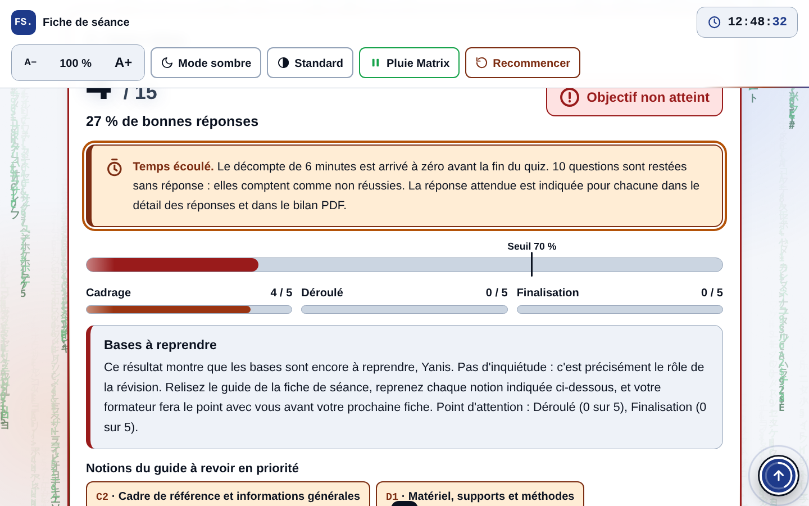 |

### Le bilan PDF

Un PDF A4 en texte réel, sélectionnable et lisible par les lecteurs d'écran.

<div align="center">
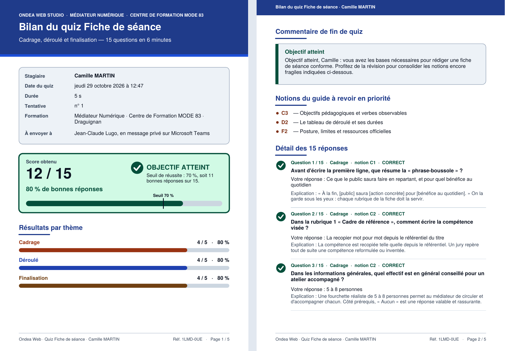
</div>

### Contraste maximal et version mobile

| Contraste maximal | Mobile · accueil | Mobile · question |
|:---:|:---:|:---:|
| 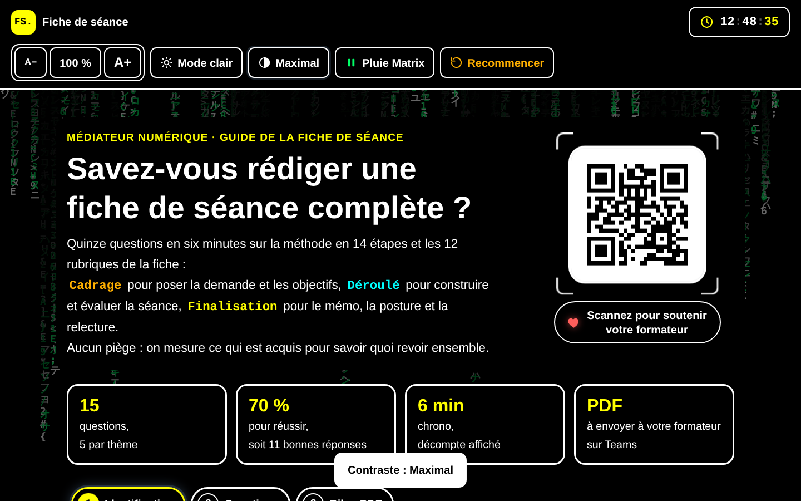 | 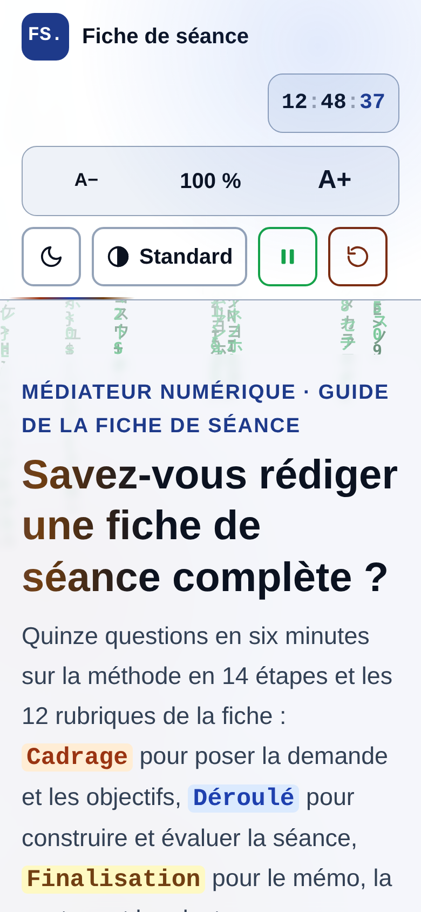 | 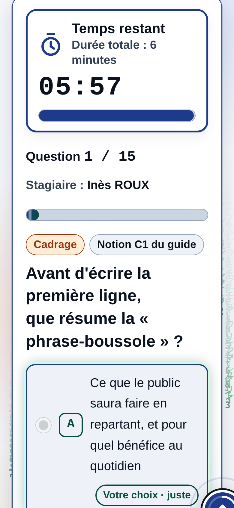 |

---

## 🧭 Déroulement du quiz

```text
┌──────────────────┐     ┌──────────────────────────┐     ┌──────────────────────┐
│ 1. Identification│ ──▶ │ 2. Questions (6 minutes) │ ──▶ │ 3. Bilan PDF         │
│ prénom + nom     │     │ 15 questions, 1 réponse  │     │ score, commentaire,  │
│                  │     │ corrigée aussitôt        │     │ envoi sur Teams      │
└──────────────────┘     └──────────────────────────┘     └──────────────────────┘
```

1. **Identification** : prénom et nom obligatoires (lettres, espaces, tirets et apostrophes).
2. **Questions** : une seule bonne réponse par question. Une fois validée, la réponse est définitive et l'explication s'affiche. L'ordre des réponses est mélangé à chaque tentative.
3. **Bilan** : score sur 15, verdict, résultats par thème, notions à revoir, détail des 15 réponses et bilan PDF.

Le seuil de réussite est fixé à **70 %**, soit **11 bonnes réponses sur 15**.

---

## ⏱️ Le décompte de 6 minutes

| Temps restant | Affichage |
|---|---|
| De 6:00 à 2:01 | Bleu · « Durée totale : 6 minutes » |
| De 2:00 à 1:01 | 🟧 Orange · « Moins de 2 minutes » |
| De 1:00 à 0:01 | 🟥 Rouge, bordure épaisse · « Dernière minute ! » |
| 0:00 | Quiz verrouillé, puis bilan automatique |

- Le décompte part du clic sur **Commencer le quiz** et continue même si la page est rechargée.
- Des **annonces vocales** pour les lecteurs d'écran signalent 5 min, 3 min, 2 min, 1 min, 30 s et 10 s.
- À 00:00, chaque question sans réponse compte comme **non réussie**. Elle est marquée « Sans réponse » dans le bilan et dans le PDF.
- Les boutons **Recommencer** et **Nouvelle tentative** restent verrouillés jusqu'à la fin des 6 minutes, avec un cadenas et le temps d'attente affiché.

---

## ❓ Les 15 questions

| N° | Thème | Notion | Question |
|:---:|---|:---:|---|
| 1 | Cadrage | C1 | Que résume la « phrase-boussole » ? |
| 2 | Cadrage | C2 | Comment écrire la compétence visée ? |
| 3 | Cadrage | C2 | Quel effectif pour un atelier accompagné ? |
| 4 | Cadrage | C3 | Quel verbe convient à un objectif opérationnel ? |
| 5 | Cadrage | C3 | Comment vérifier qu'un objectif est bien rédigé ? |
| 6 | Déroulé | D1 | Que préciser pour chaque élément du matériel ? |
| 7 | Déroulé | D1 | Quelle formule résume une méthode active ? |
| 8 | Déroulé | D2 | Quelles sont les quatre colonnes du déroulé ? |
| 9 | Déroulé | D2 | Que faire si les durées ne font pas la durée annoncée ? |
| 10 | Déroulé | D3 | Quels sont les deux moments de l'évaluation ? |
| 11 | Finalisation | F1 | Quel document remet-on aux participants ? |
| 12 | Finalisation | F1 | Quelle adaptation pour l'accessibilité ? |
| 13 | Finalisation | F2 | Un participant dicte son mot de passe : quelle posture ? |
| 14 | Finalisation | F2 | Que mettre dans les ressources officielles ? |
| 15 | Finalisation | F3 | Quand remplir le bilan de la séance ? |

Les **9 notions** du guide utilisées pour les recommandations :

| Code | Notion |
|:---:|---|
| C1 | Cerner la demande : la phrase-boussole |
| C2 | Cadre de référence et informations générales |
| C3 | Objectifs pédagogiques et verbes observables |
| D1 | Matériel, supports et méthodes |
| D2 | Le tableau de déroulé et ses durées |
| D3 | L'évaluation des acquis |
| F1 | Mémo remis et accessibilité |
| F2 | Posture, limites et ressources officielles |
| F3 | Bilan de la séance et relecture |

---

## 📄 Le bilan et le PDF

Le bilan affiché à l'écran et le PDF contiennent :

- l'identité du stagiaire, la date, la **durée réelle**, le numéro de tentative et une **référence unique** ;
- le score, le pourcentage et le verdict **Objectif atteint** ou **Objectif non atteint** ;
- une jauge par thème : Cadrage, Déroulé, Finalisation ;
- un commentaire adapté au score (sans-faute, très bon niveau, objectif atteint, presque atteint, bases à reprendre) ;
- les notions du guide à revoir en priorité ;
- le détail des 15 réponses avec la réponse attendue et son explication.

Le fichier est nommé automatiquement :

```text
Bilan-quiz-Fiche-seance_NOM_Prenom_AAAA-MM-JJ.pdf
```

Deux façons de l'obtenir :

| Bouton | Résultat |
|---|---|
| **Télécharger mon bilan PDF** | PDF généré directement (bibliothèque jsPDF) |
| **Imprimer ou PDF balisé** | Impression du navigateur → « Enregistrer au format PDF ». PDF structuré en titres et listes, le plus confortable avec un lecteur d'écran |

> ℹ️ Si la bibliothèque jsPDF ne peut pas se charger (poste hors ligne), le bouton bascule automatiquement sur l'impression en PDF.

---

## ✨ Fonctionnalités

| Fonction | Description |
|---|---|
| ⏱️ **Décompte de 6 minutes** | Couleurs d'alerte, annonces vocales, verrouillage à 00:00 |
| 🔀 **Réponses mélangées** | Ordre différent à chaque tentative |
| ✅ **Correction immédiate** | Réponse attendue et explication après chaque validation |
| 💾 **Reprise automatique** | Le quiz reprend où il s'était arrêté après un rechargement |
| 🔢 **Tentatives comptées** | Le numéro de tentative figure sur le bilan |
| 📄 **Bilan PDF** | Généré dans le navigateur, prêt à envoyer sur Teams |
| 🌗 **Thème clair / sombre** | Automatique ou manuel, avec révélation circulaire |
| ◐ **3 niveaux de contraste** | Standard, Renforcé, Maximal |
| 🔠 **Taille du texte** | De 85 % à 200 % |
| 🕒 **Horloge** | Heure en temps réel dans la barre d'outils |
| 🟩 **Pluie Matrix** | Animation de fond, à mettre en pause d'un clic |
| ⬆️ **Retour en haut** | Bouton avec anneau de progression et son |
| ☕ **QR code Ko-fi** | Carte animée dans l'en-tête |

---

## 📁 Structure du projet

```text
quiz-fiche-de-seance/
├── index.html                  ← le quiz complet (HTML, CSS et JavaScript intégrés)
├── qr-kofi.png                 ← QR code Ko-fi affiché dans l'en-tête
├── README.md                   ← ce fichier
└── docs/
    └── images/                 ← captures d'écran du README
        ├── 01-intro.png
        ├── 02-accueil-clair.png
        ├── 03-accueil-sombre.png
        ├── 04-identification.png
        ├── 05-question.png
        ├── 06-bonne-reponse.png
        ├── 07-mauvaise-reponse.png
        ├── 08-moins-de-2-minutes.png
        ├── 09-bilan.png
        ├── 10-envoi-teams.png
        ├── 11-temps-ecoule.png
        ├── 12-bilan-temps-ecoule.png
        ├── 13-contraste-maximal.png
        ├── 14-mobile-accueil.png
        ├── 15-mobile-question.png
        └── 16-bilan-pdf.png
```

> ⚠️ **Important :** le fichier `qr-kofi.png` doit se trouver **à côté de `index.html`**, sinon la carte Ko-fi affichera une image cassée.

---

## 🚀 Mise en ligne sur GitHub Pages

### 1. Créer le dépôt

1. Connectez-vous sur [github.com](https://github.com).
2. Cliquez sur **New repository**.
3. Nommez-le `quiz-fiche-de-seance`, laissez-le en **Public**, puis cliquez sur **Create repository**.

### 2. Envoyer les fichiers

**Option A — depuis le navigateur**

1. Dans le dépôt vide, cliquez sur **uploading an existing file**.
2. Glissez-déposez `index.html`, `qr-kofi.png`, `README.md` et le dossier `docs`.
3. Cliquez sur **Commit changes**.

**Option B — en ligne de commande**

```bash
cd quiz-fiche-de-seance
git init
git add .
git commit -m "Quiz Fiche de séance : 15 questions en 6 minutes"
git branch -M main
git remote add origin https://github.com/pythonman83/quiz-fiche-de-seance.git
git push -u origin main
```

### 3. Activer GitHub Pages

1. Dans le dépôt, ouvrez **Settings** → **Pages**.
2. Sous **Build and deployment**, choisissez **Source : Deploy from a branch**.
3. Sélectionnez la branche **`main`** et le dossier **`/ (root)`**, puis **Save**.
4. Patientez une à deux minutes, puis rechargez la page.

Le quiz est en ligne à l'adresse :

```text
https://pythonman83.github.io/quiz-fiche-de-seance/
```

> 💡 Avec un autre nom de dépôt, remplacez `quiz-fiche-de-seance` dans l'adresse et dans le badge « Passer le quiz » en haut de ce README.

### 4. Vérifier

- [ ] L'animation d'ouverture s'affiche puis disparaît ;
- [ ] Le QR code Ko-fi apparaît dans l'en-tête ;
- [ ] Le décompte démarre à **06:00** au lancement du quiz ;
- [ ] Le bouton **Télécharger mon bilan PDF** produit un fichier.

---

## 💻 Utilisation en local

Double-cliquez sur `index.html` : le quiz s'ouvre dans le navigateur. Une connexion internet est utile pour les polices et le bilan PDF direct ; sans connexion, le bilan reste disponible par **Imprimer ou PDF balisé**.

Pour un petit serveur local :

```bash
python -m http.server 8000
# puis ouvrir http://localhost:8000
```

---

## 🎨 Personnalisation

Les réglages se trouvent au début des scripts de `index.html`.

### Formateur et formation

```js
const TRAINER = {
  name: "Jean-Claude Lugo",
  role: "Formateur expert, Centre de Formation MODE 83",
  teamsEmail: ""   /* facultatif : ajoute un bouton « Ouvrir la conversation Teams » */
};
const PROGRAM = "Médiateur Numérique · Centre de Formation MODE 83 · Draguignan";
const PASS = 70;   /* seuil de réussite en % */
```

### Durée du quiz

La durée apparaît **deux fois** : dans le script du décompte et dans celui du verrou « Recommencer ». Modifiez les deux lignes :

```js
const DUREE = 6 * 60 * 1000;   /* 6 minutes, en millisecondes */
```

Pensez aussi à mettre à jour les textes « 6 minutes » et « 06:00 » de la page.

### Modifier une question

Chaque question suit ce format dans le tableau `Q` :

```js
{id:"q1", lang:"html", lesson:"c1",
 q:"Texte de la question ?",
 o:["Réponse A","Réponse B","Réponse C","Réponse D"],
 a:0,                       /* index de la bonne réponse dans o */
 why:"Explication affichée après validation."}
```

- `lang` : `html` = Cadrage, `css` = Déroulé, `js` = Finalisation ;
- `lesson` : code d'une notion du tableau `LESSONS` ;
- conservez **5 questions par thème** pour que les jauges restent sur 5.

### Remplacer le QR code

Remplacez `qr-kofi.png` par votre image (carrée, 384 × 384 px conseillé) et modifiez le lien `https://ko-fi.com/ondeaweb` dans le dernier script de la page.

---

## ♿ Accessibilité

- Lien d'évitement **« Aller au quiz »** et navigation complète au clavier ;
- Contour de focus épais et visible, zones cliquables d'au moins **44 × 44 px** ;
- **Trois niveaux de contraste**, jusqu'au jaune et cyan sur noir ;
- Taille du texte réglable jusqu'à **200 %** ;
- Décompte annoncé aux lecteurs d'écran, sans bavardage à chaque seconde ;
- Statut toujours écrit en toutes lettres (« Bonne réponse », « Sans réponse », « Objectif atteint »), pas seulement en couleur ;
- Respect de **« réduire les animations »** et pluie Matrix désactivable ;
- Bilan imprimable en PDF balisé ; PDF direct en texte réel, avec titre et langue renseignés ;
- Police **Atkinson Hyperlegible**, conçue pour les personnes malvoyantes.

---

## 💾 Données enregistrées

Le quiz n'envoie **aucune donnée** et ne contient **aucun traceur**. Tout reste dans le `localStorage` du navigateur du stagiaire :

| Clé | Contenu |
|---|---|
| `ondea-fiche-seance-quiz-state` | Prénom, nom, réponses en cours, heure de début et de fin |
| `ondea-fiche-seance-quiz-attempts` | Nombre de tentatives par stagiaire |
| `ondea-fiche-seance-quiz-timeout` | Tentative arrêtée par le décompte |
| `ondea-mc-theme`, `ondea-mc-contrast`, `ondea-mc-scale` | Thème, contraste et taille du texte |
| `ondea-mc-matrix-v2` | Pluie Matrix active ou en pause |

Seul le **PDF** généré à la fin est transmis au formateur, par le stagiaire lui-même.

> 💡 Sur un **poste partagé**, chaque stagiaire peut cliquer sur **Recommencer** à la fin des 6 minutes : les réponses et les champs prénom et nom sont effacés.

---

## 🌐 Compatibilité

| Navigateur | Prise en charge |
|---|---|
| Chrome / Edge (récents) | ✅ Complète, y compris la transition de thème circulaire |
| Firefox (récent) | ✅ Complète |
| Safari macOS / iOS (récents) | ✅ Complète |
| Navigateurs anciens | ⚠️ Quiz utilisable, effets avancés ignorés |

---

## 👤 Auteur et soutien

**Jean-Claude Lugo** — Formateur expert, Centre de Formation MODE 83 (Draguignan, Var)
**Ondea Web Studio**

- 🐙 GitHub : [@pythonman83](https://github.com/pythonman83)
- ☕ Ko-fi : [ko-fi.com/ondeaweb](https://ko-fi.com/ondeaweb)
- 🛒 Gumroad : [ljcwhisper8.gumroad.com](https://ljcwhisper8.gumroad.com)
- 🛍️ Payhip : [payhip.com/OndeaWeb](https://payhip.com/OndeaWeb)

À utiliser avec le **[Guide de la fiche de séance](https://pythonman83.github.io/fiche-de-seance/)**.

---

<div align="center">

*Quiz Fiche de séance · Médiateur Numérique (RNCP 40695) · 15 questions en 6 minutes*

</div>
